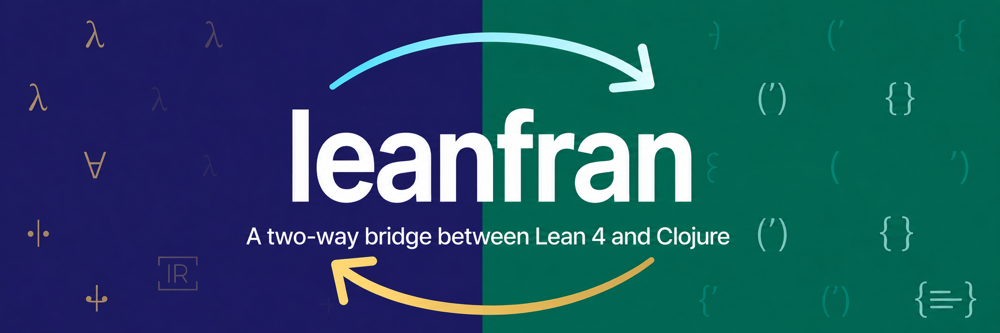

<p align="center">
  
</p>

<p align="center">
  <b>A two-way bridge between Lean 4 and Clojure</b>
</p>

<p align="center">
  <a href="https://github.com/conao3/lean-clj/tags"></a>
  <a href="https://github.com/conao3/lean-clj/actions/workflows/ci.yml"></a>
  <a href="LICENSE"></a>
  <a href="https://lean-lang.org/"></a>
  <a href="https://clojars.org/io.github.conao3/lean-clj"></a>
  <a href="https://github.com/conao3/lean-clj/stargazers"></a>
</p>

<p align="center">
  <a href="#installation">Installation</a> ·
  <a href="#quick-start">Quick start</a> ·
  <a href="#deflean">deflean</a> ·
  <a href="#verifying-clojure-functions">Verifying Clojure</a> ·
  <a href="#the-cli">CLI</a> ·
  <a href="#samples">Samples</a> ·
  <a href="https://clojars.org/io.github.conao3/lean-clj">Clojars</a> ·
  <a href="https://github.com/conao3/lean-clj/tags">Releases</a>
</p>

---

Write a function in Lean 4, prove its properties, and call it from Clojure on
the JVM. lean-clj compiles Lean's own compiler IR to Clojure, so the code you
run is the program Lean's C backend builds, with types and proofs erased.

lean-clj has three parts:

| Part | What you do | What you get |
|---|---|---|
| **Lean IR → Clojure backend** | Run the `lean-clj` CLI on a Lean module, from a file or a lake project | A Clojure namespace you can commit and load without Lean |
| **`deflean`** | Write Lean inside a Clojure file, as S-expressions or as Lean source | Functions in the current namespace, checked with `lake build` (proofs included) at macro expansion |
| **`lean-clj.typed`** | Write a Clojure function with a Lean signature and prove theorems about it in `deflean` | Proofs about the Clojure function, and test.check generators, malli schemas, and clj-kondo types from the signature |

## Quick start

```clojure
(ns demo.core
  (:refer-clojure :exclude [double])
  (:require [lean-clj.core :refer [deflean]]))

(deflean arith
  (def double [n Nat] Nat
    (+ n n))

  (theorem double_eq [n Nat] (= (double n) (* 2 n))
    (by (unfold double) omega))

  (structure Account [owner String balance Nat])

  (def deposit [a Account n Nat] Account
    (with a {:balance (+ (.balance a) n)})))

(double 21)                                ;=> 42
(deposit {:owner "ann" :balance 10} 5)     ;=> {:owner "ann", :balance 15}
```

If a proof in the block fails, compilation stops and prints Lean's error
messages next to the Lean source of the block.

## Installation

Add lean-clj to `deps.edn` ([Clojars](https://clojars.org/io.github.conao3/lean-clj)):

```clojure
{:deps {io.github.conao3/lean-clj {:mvn/version "0.2.0"}}}
```

The first expansion of a `deflean` block needs Lean 4.35.0 (`lean`, `lake`)
and the `lean-clj` CLI on `PATH`:

```
nix profile install github:conao3/lean-clj/v0.2.0
```

Get Lean from elan (`elan default v4.35.0`) or from `nix develop` of this
repository, which also provides Clojure and a JDK. To run generated code, or to
expand a block whose output sits in `.lean-clj/cache/`, you need Clojure 1.12
on JDK 21 or later and no Lean.

## Values

Public functions convert arguments and results between Clojure and Lean values
according to the Lean signature:

| Lean | Clojure |
|---|---|
| `Nat`, `Int`, `UInt8`..`UInt64`, `Float` | numbers (`BigInt` beyond `Long`) |
| `Bool` | `true` / `false` |
| `Char` | `Character` |
| `String` | string |
| `List α` / `Array α` | list / vector |
| `Option α` | the value or `nil` |
| `α × β` | two-element vector |
| structures | maps with keyword keys |
| enumerations | keywords (`Suit.hearts` → `:hearts`) |

Other types pass through in the runtime representation (`Ctor` objects, and
`Closure` objects that also implement `IFn`).

Inside generated code, `Nat` and `Int` are `Long`/`BigInt`, fixed-width
integers and `Bool` are `Long`, `UInt64` holds the 64-bit pattern in a `Long`,
`String` positions are UTF-8 byte offsets as in Lean, and `Array` is a
persistent vector.

## `deflean`

```clojure
(deflean <block> [{:imports ["Std.Data.HashMap"]}] <command> ...)
```

Each command is an S-expression of `lean-clj.dsl` or a string of Lean source.
`lean-clj.dsl/render` shows the Lean source of a sequence of commands.

| S-expression | Lean |
|---|---|
| `(def f [x T y U] R body)` | `def f (x : T) (y : U) : R := body` |
| `(theorem t [x T] P proof)` | `theorem t (x : T) : P := proof` |
| `(structure S [f T g U] (deriving Repr))` | `structure S where f : T ...` |
| `(inductive I a (b [x T]))` | `inductive I where \| a \| b (x : T)` |
| `(instance C body)`, `(mutual ...)`, `(namespace N ...)`, `(open N)` | the same commands |
| `(f a b)`, `(+ a b c)`, `(- a)`, `(not p)` | `(f a b)`, `(a + b + c)`, `(-a)`, `(¬p)` |
| `(if c t e)`, `(if h c t e)`, `(let [x v] e)`, `(fn [x] e)` | `if`, `if h : c then`, `let`, `fun` |
| `(match x p1 e1 p2 e2)`, `(match [x y] [p q] e)`, `(match-eq h x ...)` | `match x with \| p1 => e1 ...`, `match h : x with` |
| `(.field x)`, `(.method x a)` | `x.field`, `(x.method a)` |
| `{:x 1}`, `(with s {:x 1})`, `(<> a b)` | `{ x := 1 }`, `{ s with x := 1 }`, `⟨a, b⟩` |
| `[a b]`, `(array a b)` | `[a, b]`, `#[a, b]` |
| `(the T e)`, `(-> A B)`, `(forall [x T] P)`, `(exists [x T] P)` | `(e : T)`, `A → B`, `∀`, `∃` |
| `(by (simp [a b]) omega)` | `(by simp [a, b]; omega)` |
| `(lean "...")` | Lean source as is |

Names:

- A `-` in a symbol becomes lowerCamelCase in Lean (`is-prime` → `isPrime`),
  and the public Clojure name converts back (`is-prime`). lean-clj keeps `_`,
  so you write Lean lemma names as they are (`Nat.add_comm`).
- Binder vectors take `(implicit α Type)` and `(inst (BEq α))`. Metadata on a
  name adds modifiers (`^:partial`, `^:private`, `^{:attrs [simp]}`), and
  `:termination-by` and `:decreasing-by` on a `def` add `termination_by` and
  `decreasing_by`.
- Inside `by`, a `-` in a tactic name becomes `_` (`all-goals` → `all_goals`).
  `(on-all t1 t2)` is `t1 <;> t2`, and `(case tag [x] t ...)` is
  `case tag x => ...`.

Binary operators: `+ - * / % pow ++ = == != not= < <= > >= and or iff && ||
band bor land lor xor <<< >>> in not-in cons |> <| >>= <$> comp`.

The block becomes the Lean module `LeanCljEmbed.<Namespace>.<Block>` (for
`demo.core` and `arith`: `LeanCljEmbed.Demo.Core.Arith`) in the lake workspace
`.lean-clj/` of the working directory. lean-clj caches the generated code in
`.lean-clj/cache/` under a hash of the namespace, block name, imports, and
Lean source. With the cache present, expanding the block needs no Lean.

clj-kondo picks up the names a block defines through the hook exported in
`resources/clj-kondo.exports/io.github.conao3/lean-clj`.

## Verifying Clojure functions

`lean-clj.typed/defn` defines an ordinary Clojure function with a Lean
signature. `(clojure f ...)` in a `deflean` block translates the function into
a Lean definition, its model, to state and prove theorems about:

```clojure
(require '[lean-clj.typed :as lt])

(lt/defn insert-sorted [x Int xs (List Int)] (List Int)
  (if-let [y (first xs)]
    (if (<= x y) (cons x xs) (cons y (insert-sorted x (rest xs))))
    (list x)))

(deflean sorting
  (clojure insert-sorted)

  (theorem insert-sorted-length [x Int xs (List Int)]
    (= (.length (insert-sorted x xs)) (+ (.length xs) 1))
    (by (on-all (fun-induction insert-sorted x xs) simp-all grind))))
```

- The models of `clojure.core` functions are in the Lean library `Clj`
  ([`resources/lean-clj/lean/Clj.lean`](resources/lean-clj/lean/Clj.lean)),
  with simp lemmas back to Lean's own operations. Each model is compared with
  `clojure.core` on generated inputs in `test/lean_clj/core_model_test.clj`.
  Where Clojure's meaning depends on the type, a model has instances only for
  the types on which Lean can state it: `-` and `dec` take `Int`, and `first`,
  `next`, `seq`, and `get` return `Option`.
- The translation takes `if`, `when`, `cond`, `if-let`, `if-some`,
  `when-let`, `case` on keywords and literals, `let`, `fn`, `and`, `or`,
  keyword lookup, `assoc` and `update` of structure fields, self recursion and
  `recur`, `lean-clj.typed/loop` (`[i Nat 0 ...]`), and macros that expand to
  these (`->`, `->>`). Other forms stop the translation with an error.
- Lean proves termination itself for recursion on `(rest xs)` under
  `(if-let [y (first xs)] ...)`. Otherwise put `:termination-by` (a Lean term)
  and `:decreasing-by` metadata on the function name or the `loop` vector.
- The model of a translated function is `@[extern]` to the Clojure var, so
  Lean code that calls it runs the Clojure function. A `@[csimp]` theorem
  `(= (the (-> Nat Nat) spec) impl)` makes compiled calls of `spec`, and the
  Clojure function `spec` itself, run the Clojure `impl`.
- `(lt/check #'f)` compares `f` with its model on inputs generated from the
  signature, with test.check.

A theorem holds for the Clojure function where the function returns a value:
calls that throw (`Long` overflow, division by zero, an index out of range)
are outside what the models describe. Signatures take monomorphic types.

## Types

`lean-clj.types` derives from a Lean type, written as in signatures:

| Function | Result |
|---|---|
| `gen` | a test.check generator of the Clojure values of the type |
| `valid?` | whether a value has the type, telling lists from vectors |
| `malli-schema`, `fn-schema` | a malli schema as data, and `[:=> [:cat ...] ...]` for a `lt/defn` var |
| `kondo-type`, `kondo-config`, `write-kondo-config!` | clj-kondo `:type-mismatch` types of `lt/defn` functions, written to `.clj-kondo/lean-clj/types/config.edn` |

Structures and enumerations are known by name once a `deflean` block defines
them with `structure` and `inductive`.

## The CLI

```
lean-clj module generate-namespace --module-name <Lean module> --namespace <Clojure ns>
         [--roots <Lean name> ...] [--strip-namespace <Lean namespace>]
         [--search-path <dir> ...] [--output-file <path>] [--forms-only]
         [--output json|text]
```

Without `--roots`, the CLI exports the public definitions of the module that
have a supported signature. `--search-path` adds directories of `.olean` files
(in a lake package, `.lake/build/lib/lean`). Exit codes: 0 success, 252 invalid
parameters, 254 input the backend cannot handle, 255 other failures.

Public functions take the Lean name relative to the module (or
`--strip-namespace`) in kebab-case: `Point.add` → `point-add`, `isEven?` →
`is-even?`.

The backend works on Lean's compiler IR. A hand-written runtime
(`lean-clj.runtime`) provides the C symbols of Lean's `@[extern]`
declarations, and a generated namespace checks at load time that the runtime
has the symbols it uses.

## Samples

[`samples/`](samples) holds small programs built with lean-clj. Each one is a
Clojure project with its own README and a `make test`.

| Sample | What it shows |
|---|---|
| [`todo-cli`](samples/todo-cli) | `deflean` in S-expressions: structures and theorems about the list operations, behind a Clojure CLI |
| [`word-count`](samples/word-count) | `deflean` with `:imports` (`Std.HashMap`) and Lean source in a string next to S-expressions, for `do` notation |
| [`roman-numerals`](samples/roman-numerals) | a lake project compiled with the `lean-clj` CLI to a committed Clojure namespace that runs without Lean |
| [`verified-clojure`](samples/verified-clojure) | Clojure functions written with `lean-clj.typed/defn` and proved in Lean, and a Lean specification that runs as a Clojure closed form through `@[csimp]` |

Start with `todo-cli`. See [`samples/README.md`](samples/README.md) for how to
run them.

## Development

```
make build     # lake build
make test      # diff-test against the C backend, then the Clojure tests
make check     # format check, lint, and all tests
make format
```

`./test-diff.sh` runs `LeanCljTest.Vectors.report` compiled by Lean's C backend
and the same function generated as Clojure, and compares the output.

The `Release` workflow publishes releases (Actions → Release → Run workflow,
choosing `patch`, `minor`, or `major`). It raises the version with
`clojure -T:build bump :part <part>`, runs `make check`, pushes the commit and
the tag `vX.Y.Z` to `master`, and deploys the jar to Clojars.

## License

Apache-2.0. See [LICENSE](LICENSE).
