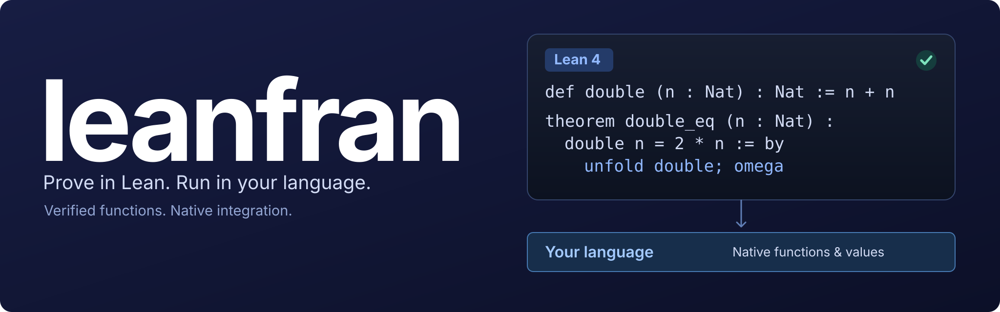

<p align="center">
  
</p>

<p align="center"><strong>Write it in Lean. Prove it in Lean. Run it in your language.</strong></p>

<p align="center">
  <a href="https://github.com/conao3/lean-leanfran/tags"></a>
  <a href="https://github.com/conao3/lean-leanfran/actions/workflows/ci.yml"></a>
  <a href="LICENSE"></a>
  <a href="lean-toolchain"></a>
  <a href="https://github.com/conao3/lean-leanfran/stargazers"></a>
</p>

<p align="center">
  <a href="https://crates.io/crates/leanfran"></a>
  <a href="https://pypi.org/project/leanfran/"></a>
  <a href="https://www.npmjs.com/package/leanfran"></a>
  <a href="https://clojars.org/io.github.conao3/leanfran"></a>
</p>

<p align="center">
  <a href="#get-started">Get started</a> ·
  <a href="#lean-at-the-core">Languages</a> ·
  <a href="#what-you-can-build">Features</a> ·
  <a href="#documentation">Documentation &amp; examples</a> ·
  <a href="CONTRIBUTING.md">Contributing</a>
</p>

# leanfran

leanfran brings Lean 4 to your programming language. Write functions and proofs together, compile them to your application's language, and call them through native types. The generated code runs with a small host-language runtime; Lean is needed to check and generate code, not to run the result.

## Lean at the core

```lean
def double (n : Nat) : Nat := n + n

theorem double_eq (n : Nat) : double n = 2 * n := by
  unfold double
  omega
```

leanfran compiles Lean's compiler IR into source code for the selected language. You can generate code from a Lean project or embed Lean blocks directly in host-language source files. Proofs are checked by Lean during generation and erased from the executable code.

| Language   | Start here                                     | Package                                                                               | Integration                                    |
| ---------- | ---------------------------------------------- | ------------------------------------------------------------------------------------- | ---------------------------------------------- |
| Rust       | [Rust quick start](langs/Rust/README.md)             | [leanfran on crates.io](https://crates.io/crates/leanfran)                            | `lean!`, Rust types, Cargo build integration   |
| Python     | [Python quick start](langs/Python/README.md)         | [leanfran on PyPI](https://pypi.org/project/leanfran/)                                | `lean(...)`, pydantic models, Python modules   |
| TypeScript | [TypeScript quick start](langs/TypeScript/README.md) | [leanfran on npm](https://www.npmjs.com/package/leanfran)                             | `lean(...)`, TypeScript types, Standard Schema |
| Clojure    | [Clojure quick start](langs/Clojure/README.md)       | [io.github.conao3/leanfran on Clojars](https://clojars.org/io.github.conao3/leanfran) | `deflean`, Clojure values, JVM namespaces      |

## What you can build

- **Proved functions in your application.** Keep an algorithm and its correctness proof together, then call the generated function from your application.
- **Validated data at the boundary.** Lean structures and inductive types map to host-language values. Supported proof fields become runtime checks for the invariants your proofs assume.
- **Specifications for host-language code.** Bind supported Rust, Python, TypeScript or Clojure functions to Lean specifications, translate them to Lean, and check proof obligations. Each language guide describes its supported subset and verification tools.

The backends share Lean's semantics and are tested against Lean's native C backend. Their supported types, externs and host-language integrations are documented in the [language guides](#documentation).

## Get started

Choose a language above and install its host package and compiler. Lean 4.35.0 is required for generation and proof checking. With Nix, install a compiler from this repository:

```sh
nix profile install 'github:conao3/lean-leanfran#python'
```

Use `#rust`, `#typescript` or `#clojure` for the other targets. The Rust package also includes the Cargo CLI and Aeneas verification tools. Follow the language quick start for dependencies, project setup and generation commands.

## Documentation

| Language   | Quick start                                   | Full guide                                                | Examples                                           |
| ---------- | --------------------------------------------- | --------------------------------------------------------- | -------------------------------------------------- |
| Rust       | [Setup and first block](langs/Rust/README.md)       | [Types, verification and CLI](docs/rust-guide.md)         | [Rust samples](langs/Rust/samples/README.md)             |
| Python     | [Setup and first block](langs/Python/README.md)     | [Models, verification and CLI](docs/python-guide.md)      | [Python samples](langs/Python/samples/README.md)         |
| TypeScript | [Setup and first block](langs/TypeScript/README.md) | [Schemas, verification and CLI](docs/typescript-guide.md) | [TypeScript samples](langs/TypeScript/samples/README.md) |
| Clojure    | [Setup and first block](langs/Clojure/README.md)    | [Types, verification and CLI](docs/clojure-guide.md)      | [Clojure samples](langs/Clojure/samples/README.md)       |

## Development

The repository has one Nix environment and Lean toolchain, with language-specific source and packages in `langs/Rust/`, `langs/Python/`, `langs/TypeScript/` and `langs/Clojure/`.

```sh
nix develop
make check
make check BACKENDS=Python
```

See [CONTRIBUTING.md](CONTRIBUTING.md) for build targets, formatting, packaging and the coordinated release process. Implementation notes live in [docs/](docs/); maintenance tools live in [maint/](maint/).

## License

[Apache-2.0](LICENSE).
