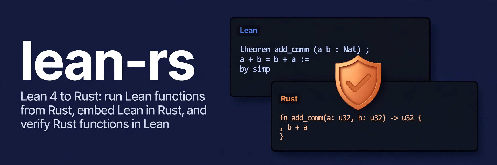

<p align="center">
  
</p>

<p align="center"><strong>Run Lean 4 functions from Rust, and verify Rust functions in Lean</strong></p>

<p align="center">
  <a href="https://crates.io/crates/lean-rust"></a>
  <a href="https://github.com/conao3/lean-rs/actions/workflows/ci.yml"></a>
  <a href="LICENSE"></a>
  <a href="lean-toolchain"></a>
  <a href="Cargo.toml"></a>
  <a href="https://github.com/conao3/lean-rs/stargazers"></a>
</p>

<p align="center">
  <a href="#install">Install</a> ·
  <a href="#quick-start-lean">Quick start</a> ·
  <a href="#values">Values</a> ·
  <a href="#verifying-rust-functions">Verifying Rust functions</a> ·
  <a href="samples/steps">Samples</a> ·
  <a href="https://crates.io/crates/lean-rust">crates.io</a>
</p>

# lean-rs

Write functions in Lean 4, prove their properties in Lean, and call them from Rust; verify Rust
functions against specs written in Lean. lean-rs compiles Lean's IR (`Lean.Compiler.IR`) to Rust
source that builds with cargo alone: the generated code needs neither the Lean toolchain nor
Lean's C runtime, only the crate `lean-rust-runtime`.

lean-rs has four parts:

- **A Rust backend for Lean** (`lean-rust module generate`). It reads the IR of a compiled Lean
  module and emits Rust that mirrors Lean's C backend: the same object layout, reference
  counting and in-place updates. Every public definition becomes a safe Rust function on Rust
  types.
- **`lean!`**, Lean source in a Rust file. The crate's build script checks the source and its
  proofs with `lake build`, generates the Rust module, and caches it in the repository, so
  builds without Lean (CI, crates.io users, docs.rs) use the cache
  ([Quick start: `lean!`](#quick-start-lean)).
- **`lean-rust project generate`**, which compiles every module of a lake project to a Rust
  module file plus a `mod.rs`, for committing to a Rust crate
  ([Quick start: a lake project](#quick-start-a-lake-project)).
- **`#[lean_rust::model]` and `cargo lean-rust`**, which bind a Rust function to Lean specs,
  translate it to Lean with Charon and Aeneas, check the proofs of its obligations, and test it
  against the specs ([Verifying Rust functions](#verifying-rust-functions)).

```rust
lean_rust::lean! {
    pub mod arith;
    r#"
    def double (n : Nat) : Nat := n + n

    theorem double_eq (n : Nat) : double n = 2 * n := by
      unfold double; omega
    "#
}

fn main() {
    assert_eq!(arith::double(21u64.into()), 42u64.into());
}
```

## Install

The CLI is a Lean program. With Nix:

```
nix profile install github:conao3/lean-rs   # or `nix profile install .` in a checkout
lean-rust --version
```

or build it from a checkout with `lake build lean-rust` (Lean 4.35.0, see `lean-toolchain`); the
executable is `.lake/build/bin/lean-rust`.

The Rust crates are `lean-rust` (the facade with `lean!`, `#[model]`, the runtime and the
conversion traits), `lean-rust-runtime`, `lean-rust-macros`, `lean-rust-build` and
`cargo-lean-rust` (the `cargo lean-rust` command), all on crates.io (`cargo install
cargo-lean-rust`). The flake's default package has `lean-rust`, `cargo-lean-rust`, `charon` and
`aeneas`.

## Quick start: `lean!`

```toml
# Cargo.toml
[dependencies]
lean-rust = "0.3.0"

[build-dependencies]
lean-rust-build = "0.3.0"
```

```rust
// build.rs
fn main() {
    lean_rust_build::Builder::new().compile().unwrap();
}
```

```rust
// src/lib.rs
lean_rust::lean! {
    /// Documentation of the module.
    #[lean(imports = ["Std.Data.HashMap"], uses = [crate::geometry::shapes])]
    pub mod arith;
    r#"
    def double (n : Nat) : Nat := n + n
    "#
}
```

The build script finds every `lean!` in `src/**/*.rs`. For a block that is not in
`.lean-rust/cache/`, it writes the source (wrapped in `namespace <name>`) into the crate's Lean
package `lean/LeanRustGen/Embed/`, creating `lean/` with a `lakefile.toml` when it is missing,
runs `lake build`, and runs `lean-rust module generate`. Lean errors are reported at the Rust
file and line of the source. `imports` are Lean modules to import; `uses` are other `lean!`
blocks of the crate, whose module is imported and opened and whose generated types are shared.

| Variable | Effect |
|---|---|
| `LEAN_RUST_CLI` | the `lean-rust` executable (default: `lean-rust` on `PATH`; `lake` is always taken from `PATH`) |
| `LEAN_RUST_OFFLINE=1` | use the cache only; list the blocks missing from it and stop |
| `LEAN_RUST_EXTRACTING=1` | set by `cargo lean-rust extract` for Charon: use the cache only, skip the lockfile; `lean!` and `#[model]` expand to the bare items |
| `LEAN_RUST_REQUIRE=proved` | fail unless every obligation of the crate is `proved` |

Commit `.lean-rust/cache/` and `lean/` (its `.gitignore` excludes `lean/.lake/`), and add
`.lean-rust/cache/**` to the crate's `include` when you publish it. The macro only includes the
generated file, so rust-analyzer never runs Lean.

## Quick start: a lake project

```
lean-rust project generate --lake-dir lean --output-dir src/generated
```

builds the project, uses `lake env`'s `LEAN_PATH` as the search path, and writes
`src/generated/<module>.rs` for each module built by the package (or for `--modules ...`) and a
`mod.rs`. Declare `mod generated;` in the crate and depend on `lean-rust`.

## Values

| Lean | Rust |
|---|---|
| `Bool` (and `Decidable p`) | `bool` |
| `Nat`, `Int` | `lean_rust::Nat`, `lean_rust::Int` (arbitrary precision; `From<u64>`, `TryFrom<Nat> for u64`, `Display`, `FromStr`, arithmetic) |
| `UInt8`…`UInt64`, `USize` | `u8`…`u64`, `usize` |
| `Int8`…`Int64`, `ISize` | `i8`…`i64`, `isize` |
| `Float`, `Float32` | `f64`, `f32` |
| `Char` | `char` |
| `String` | `String` (arguments take `impl AsRef<str>`) |
| `Unit` | `()` |
| `List α`, `Array α` | `Vec<T>` |
| `Option α` | `Option<T>` |
| `Except ε α` | `Result<T, E>` |
| `α × β` | `(A, B)` |
| `Fin n` (literal `n`) | `usize`, checked against `n` (panics when out of range) |
| a structure | a generated `pub struct` with snake_case fields |
| an inductive type | a generated `pub enum` (a field-less `enum` when every constructor is nullary) |
| `IO α` | `std::io::Result<T>` (`IO.Error` becomes `std::io::Error` with Lean's message) |

Generated structs and enums derive `Debug`, `Clone` and `PartialEq`, plus `Eq` and `Hash` when
the Lean type has `DecidableEq`. Recursive fields are boxed (`Box<Tree>`).

A definition whose type uses anything else is not public; `--output json` lists it under
`skipped` with the reason: type variables, function types, `Subtype`, type families, proof
arguments, and argument types with proof fields (Rust could not keep their invariant). Type
arguments are dropped, and instance arguments of a concrete type are synthesized at generation
time. Names are the last components of the Lean name in snake_case relative to the module's
namespace (`Point.add` → `point_add`, `find?` → `find_q`, `get!` → `get_bang`, `x'` →
`x_prime`, keywords as `r#type`). Each function has a doc comment with its Lean name and type,
and `#[lean_rust::exported("<Lean name>")]`. A `@[csimp]` replacement in the definition's module
is what the function runs.

### Polymorphic functions

`rust_instances` (from `LeanRust.Instances`, which `lean!` blocks that use it import) compiles
a polymorphic function for chosen types and makes it one generic Rust function:

```rust
lean_rust::lean! {
    pub mod sorting;
    r#"
    def largest {α : Type} [Ord α] [Inhabited α] (xs : List α) : α :=
      xs.foldl (fun a b => if compare a b == .lt then b else a) default

    rust_instances largest [Nat, String]
    "#
}

fn main() {
    assert_eq!(sorting::largest(vec!["b".to_string(), "a".to_string()]), "b");
}
```

`rust_instances f [Nat, String]` defines `f.inst_Nat := @f Nat _` (the instances synthesized)
and `f.inst_String`; several type parameters take named arguments, `rust_instances g [(α := Nat)
(β := String)]`. The Rust function `largest<T: __lean_rust_inst::Largest>(xs: Vec<T>) -> T`
dispatches through a sealed trait implemented for the instantiated types only (another type is
a rustc error); the trait of a function with several type parameters is implemented for the
first one, with the others as associated types (`T::T1`). The instantiations are also public
functions (`largest_inst_nat`), and a `@[csimp]` lemma can replace one of them. A lake project
compiled with `project generate` imports `LeanRust.Instances` from this repository's `LeanRust`
library.

## WebAssembly

Generated code builds for `wasm32-unknown-unknown` (for a browser through `wasm-bindgen`) with

```toml
lean-rust = { version = "0.3.0", default-features = false }
```

Pure functions behave as on Unix. The `IO` actions that need an operating system (files,
directories, handles other than the standard streams, child processes, locks, the current
directory, random bytes, `IO.Process.exit`) return `IO.Error.unsupportedOperation` (Rust's
`ErrorKind::Unsupported`) with the message `<operation> is not supported on
wasm32-unknown-unknown`. `IO.getEnv` returns `none`, the process id is 0, the monotonic clocks
stay at their start, `dbgSleep` returns at once, the standard input is empty, and the standard
output and error (with panic messages) are discarded.

## Verifying Rust functions

`#[lean_rust::model]` binds a Rust function to specs written in Lean. Charon and Aeneas
translate the function to a Lean model; lean-rs states the obligations (Lean propositions)
from the specs, checks the proofs written in the crate's `lean/` package, and records their
states in `lean-rust.lock`. The crate stays on stable Rust: only `cargo lean-rust extract` runs
Charon (with its own nightly), and `cargo build` reads the lockfile without Lean or Charon.

```rust
lean_rust::lean! {
    #[lean(imports = ["Aeneas"])]
    pub mod bits;
    r#"
    open Aeneas Aeneas.Std

    def max (a b : Std.U32) : Std.U32 := if a.val ≤ b.val then b else a
    def max_bound (a b r : Std.U32) : Bool := decide (a.val ≤ r.val ∧ b.val ≤ r.val)
    "#
}

#[lean_rust::model(refines = bits::max, ensures(bound = bits::max_bound))]
pub fn max_u32(a: u32, b: u32) -> u32 {
    if a <= b { b } else { a }
}
```

```lean
-- lean/Proofs/Bits.lean
import LeanRustGen.Obligation.my_crate
open Aeneas Aeneas.Std Result

namespace my_crate

theorem max_u32.proof.refines : max_u32.obligation.refines := by
  intro a b
  unfold max_u32 _root_.bits.max
  by_cases h : a.val ≤ b.val <;> simp [UScalar.le_equiv, h]
```

```
$ cargo lean-rust init        # lean/ requiring Aeneas; fetches Mathlib's build cache
$ cargo lean-rust extract     # Charon + Aeneas → lean/LeanRustGen/Model/, obligations, lockfile
$ cargo lean-rust check       # lake build, then the state of every obligation
crate::max_u32
  refines  proved    axioms: Quot.sound, propext
  bound    sorry     lean/Proofs/Bits.lean:12
$ cargo test                  # proptest of each spec against the function
```

Specs are public functions generated from Lean (`lean!` or `project generate`) and are named by
their Rust path, so rustc checks the name and the argument types; a string names a Lean
definition (a `Prop` is fine) for an obligation without a test. Specs are written in the types
of Aeneas's model: `Std.U8`…`Std.I128`, `Std.Usize` (Rust `u8`…`i128`, `usize`), `Slice α` and
`alloc.vec.Vec α` (`Vec<T>`), `Std.Array α n` (`[T; N]`), `Str` (`String`), `Result α` (the value; a panic unless `ok`),
and the crate's structs and enums, which derive `lean_rust::Model` (and `Clone`).

| Key | Obligation `M.obligation.<label>` (M: the model) |
|---|---|
| `refines = spec` | `∀ args, M args = ok (spec args)` (label `refines`) |
| `requires = pre` | the assumption `pre args = true →` of every obligation; the tests draw inputs satisfying it |
| `ensures(label = post, ..)` | `∀ args, M args ⦃ r => post args r = true ⦄` (`post` takes the arguments, the result unless `()`, and the values of the `&mut` arguments after the call) |
| `check = false` | no test |
| `strategy = path` | the proptest strategy of the arguments (a value for one argument, a tuple otherwise); of a generic function, a generic function called with the types of each instance |
| `instances = [u32, i64]` | the types a generic function is tested with (a tuple per instance for several type parameters) |
| `obligations = generic \| per_instance` | the obligations of a generic function: one for every type (default), or one per type of `instances` (label `<label>.<type>`) |

On an impl block, `#[lean_rust::model]` models every method; a method's own
`#[lean_rust::model(..)]` gives its specs. `#[lean_rust::opaque]` keeps the body of a function
out of the model: its model is written in `lean/External.lean` (and the types Aeneas does not
know, such as `BTreeMap`, in `lean/ExternalTypes.lean`), starting from the templates `extract`
writes. `cargo test` compares an opaque function with its model when the model is a definition
(the build script compiles it like a `lean!` block): equal results, or a panic of the function
where the model fails. Every loop of a modelled function has a label: `'scan: for ..` in `insert_sorted` is
`insert_sorted.scan`, an alias of Aeneas's `insert_sorted_loop`, so proofs keep their names
when loops are added.

### Generic functions

A generic function is tested with the types of `instances`, and its obligation holds for every
type. Aeneas passes each trait bound as a structure of the trait's methods (`core.cmp.Ord T`);
the obligation assumes that the structure obeys the laws of a Lean class, stated by
`LeanRustGen/Lib/AeneasModel.lean` (`LeanRust/AeneasModel.lean`, written by `extract`):

| Bound | Assumption |
|---|---|
| `PartialEq`, `Eq` | `[DecidableEq T] [PartialEqModel inst]`: `eq` decides `=` |
| `PartialOrd` | `[Preorder T] [DecidableRel (· ≤ ·)] [PartialOrdModel inst]`: the comparisons decide `≤` |
| `Ord` | `[LinearOrder T] [OrdModel inst]`: `cmp` is `compare`, `max` and `min` are `max` and `min` |
| `Clone` | `[CloneModel inst]`: `clone` returns the value |
| `Copy` | nothing |
| `Default` | `[Inhabited T] [DefaultModel inst]`: `default` is `default` |

The classes have `@[step]` lemmas (`ord.partialOrdInst.lt a b ⦃ r => r = decide (a < b) ⦄`),
and Aeneas's instances of the scalars (all classes), `bool` (`PartialEq`, `Clone`), `()`, `Vec`
(`PartialEq`, `Clone`), `Box` and arrays (`Clone`) are proved to be models.

```rust
lean_rust::lean! {
    #[lean(imports = ["Aeneas"])]
    pub mod spec;
    r#"
    def max_ge {α : Type} [LinearOrder α] (a b r : α) : Bool := decide (a ≤ r ∧ b ≤ r)
    rust_instances max_ge [Std.U32, Std.I64]
    "#
}

#[lean_rust::model(instances = [u32, i64], ensures(ge = spec::max_ge))]
pub fn max_of<T: Ord + Copy>(a: T, b: T) -> T {
    if a >= b { a } else { b }
}
```

```lean
-- the obligation
def max_of.obligation.ge : Prop :=
  ∀ {T : Type} [LinearOrder T] (corecmpOrdInst : core.cmp.Ord T) [LeanRust.OrdModel corecmpOrdInst]
    (coremarkerCopyInst : core.marker.Copy T), ∀ a b,
    max_of corecmpOrdInst coremarkerCopyInst a b ⦃ res => _root_.spec.max_ge a b res (α := T) = true ⦄

theorem max_of.proof.ge : max_of.obligation.ge := by
  intro T _ ord _ copy a b
  unfold max_of
  step*
  · simp_all [_root_.spec.max_ge]
  · simp_all [_root_.spec.max_ge]
    exact le_of_lt (by simpa using ‹_›)
```

The tests call `max_of::<u32>` and `max_of::<i64>` and the spec `spec::max_ge` with the same
types: the spec is a polymorphic Lean function instantiated by `rust_instances` for the model
types of the instances. A bound without a law class (a trait of the crate, `Hash`) needs
`obligations = per_instance`: each obligation passes Aeneas's instances of the type
(`core.cmp.OrdU32`, or the crate's `Item.Insts.CoreCmpOrd`) and the instantiation of the spec
(`spec.max_ge.inst_U32`). A proved `refines` replaces the instantiation of each type whose
obligation holds: with `generic`, the types whose bounds Aeneas's library models; with
`per_instance`, the types of the proved obligations. Methods of generic impl blocks take the
type parameters of the block first, and `derive(lean_rust::Model)` implements `Model` for a
generic struct or enum when its parameters do (`impl<T: Model> Model for Pair<T>`); a spec
names it with its Aeneas type (`generic.Pair Std.U32`).

The proof of `M.obligation.l` is `theorem M.proof.l : M.obligation.l` in `lean/Proofs/`.
`cargo lean-rust check` records one of `proved` (the standard axioms only), `sorry`, `axioms`
(others, listed), `missing`, `mismatch` (another statement) or `failed` (the proof's file does
not build). `cargo build` adds `stale` (the function, a function it calls, or the spec changed
since `extract`) and `unextracted`, warns about them, and fails on any state but `proved` with
`[package.metadata.lean-rust] require = "proved"` or `LEAN_RUST_REQUIRE=proved`. The states
are in the rustdoc of each function and in `cargo lean-rust status` (`--output json`).

When a `refines` without `requires` is proved, `check` writes `lean/LeanRustGen/Csimp.lean`:
a `@[csimp]` lemma replacing the spec by an `@[extern "rs:crate::max_u32(_,_)"]` function, so
the generated `bits::max` calls the Rust `max_u32`. The tests keep comparing with the Lean
spec (`bits::__lean_rust_spec::max`). Every model also has `M.rs`, an extern calling the Rust
function from Lean (a panic is `fail panic`).

| Path | Content |
|---|---|
| `lean/lakefile.toml`, `lean/lean-toolchain` | the Lean package (`require aeneas` at the rev of this lean-rs), written by `init` |
| `lean/LeanRustGen/Model/<crate>/` | Aeneas's output |
| `lean/LeanRustGen/{Alias,Obligation,Extern}/`, `Csimp.lean` | the loop aliases, the obligations, the `rs:` externs, the csimp replacements |
| `lean/External.lean`, `lean/ExternalTypes.lean` | hand-written models of opaque functions and unknown types |
| `lean/Proofs/` | the proofs |
| `lean-rust.lock` | the items each model was extracted from with their hashes, and the state of every obligation |

Commit all of them (and `.lean-rust/cache/`). CI runs `cargo lean-rust extract && cargo lean-rust
check` and `git diff --exit-code -- lean/LeanRustGen lean-rust.lock`.

`cargo lean-rust` runs `charon` and `aeneas` (the flake's packages; Aeneas reads only the LLBC
of its own Charon), `lake` and `lean-rust` (`LEAN_RUST_CLI`) from `PATH`. Lean comes from elan:
nixpkgs' `leantar` cannot unpack Mathlib's cache. `init --packages-dir <dir>` shares Lake's
packages (Mathlib's 7.3 GB) between crates.

## The CLI

```
lean-rust module generate --module-name <Module> [--roots <Name> ...] [--namespace <Name>]
          [--search-path <dir> ...] [--output-file <path>] [--runtime-path <path>]
          [--facade-path <path>] [--type-path <Namespace>=<path> ...] [--internal-only]
          [--batch <jobs.json>] [--output json|text]
lean-rust project generate --lake-dir <dir> --output-dir <dir> [--modules <Module> ...]
lean-rust crate check --lake-dir <dir> --obligations <json> [--modules <Module> ...]
```

`--roots` defaults to the module's public definitions written in its source (not instances).
`--batch` runs several modules against one environment; `--import` adds modules whose `@[csimp]`
lemmas apply, and `--model-namespace` maps the types of a crate's Aeneas model to its Rust
types. `crate check` judges the proofs of obligations (used by `cargo lean-rust check`).
Exit codes: 0 success, 252 invalid parameters, 254 input that cannot be converted (externs the
runtime lacks, unsupported IR, clashing Rust names), 255 other errors. `lean-rust help` prints all options.

## Samples

[`samples/steps/`](samples/steps) introduces the features one crate at a time, in 17 steps from a
first `lean!` block to a generic verified function. [`samples/`](samples) also has `todo-cli`
and `word-count` (`lean!`), `roman-numerals` (a lake project with committed generated modules),
and `verified-rust`, `sorted-search`, `inventory` and `generic-search` (Rust functions verified
in Lean, the last one generic).

## Development

Inside `nix develop` (elan, Rust, cargo-nextest):

```
make check
```

runs the format check, clippy, the diff tests against Lean's C backend (`./test-diff.sh`), the
public API tests (`./test-public.sh`), the runtime and build tests, the `lean!` tests
(`tests/embed`), the tests of `tests/verify` and the samples, and builds the runtime for
`wasm32-unknown-unknown` and runs `tests/wasm` in node, all without Charon or Mathlib.

```
make check-verify
```

extracts and checks the proofs again: `tests/verify/test.sh` (extraction reproduces the
committed files; stale states, `require = "proved"`, wrong specs and a wrong implementation on
copies in `test-out/verify/`) and `make verify` of the samples. It needs Mathlib: the Lean
packages of the repository share `.lake-aeneas/packages/` (7.9 GB, git-ignored), filled by
`make aeneas-packages`.

## Limitations

- Objects use non-atomic reference counts; `Task`s run synchronously where they are created.
- The runtime builds on Unix (Linux and macOS) and on `wasm32-unknown-unknown` (see
  [WebAssembly](#webassembly)).
- `IO` follows the C runtime: files, directories, the environment, child processes (`fork` and
  `execvp`) and promises, with the same `IO.Error`s. Since tasks run synchronously,
  `IO.Process.output` reads the standard output of the child before its standard error, the
  result of an unresolved promise cannot be awaited, `IO.getNumHeartbeats` returns the value
  last set, and `allocprof` prints no profile.
- Each generated module defines its own structs and enums; two modules that mention the same
  Lean type have two Rust types, except for types of the blocks named in `uses`.
- Generic structures are generated per instantiation (`Pair Nat Bool` → `PairNatBool`).
- `#[lean_rust::model]` covers what Aeneas covers (no `unsafe`, interior mutability or
  concurrency). A trait method is extracted only for a trait of the crate. The model of an
  opaque method is not tested. Generic functions take neither const generics, trait objects nor
  `Fn` bounds; Aeneas has no instances of `Ord` for `String`, `char` and `bool`, nor of the
  traits of `Option`, `Result` and slices, so a generic proof covers those types only by test.
- A polymorphic Lean function is public only for the types of its `rust_instances`.
- Aeneas's output does not build when a parameter has the name of a module of the crate
  (`item` in the module `item`): rename the parameter.

## License

Apache-2.0
